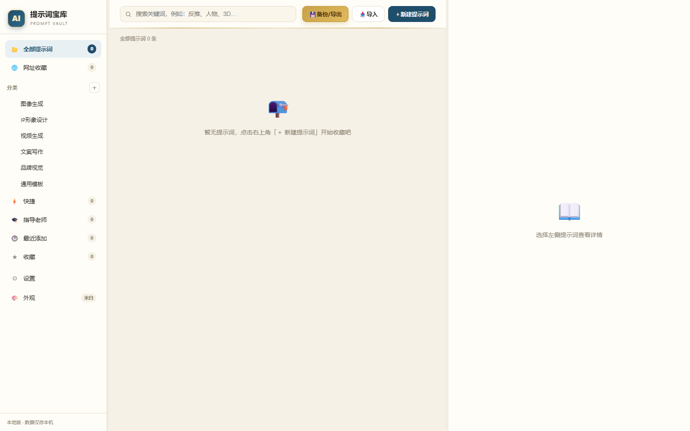
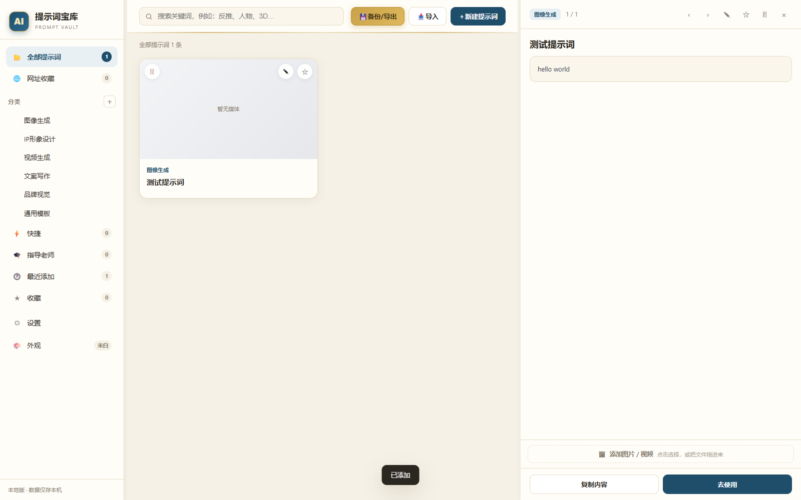

# 提示词宝库 · Prompt Vault

> 一个**纯本地、零依赖、单文件**的桌面提示词管理工具。数据 100% 存在你自己电脑上，不联网、不注册、不上传。

<p>
  
  
  
  
</p>

写着玩的时候发现，我的提示词散在备忘录、聊天记录、各种 txt 里，找一个「那种有点胶片感的暗调人像」要翻半天。
于是就想着攒一个自己的库——不连接云端，不需要登录，打开就能用。

后来加了比赛等级识别、指导老师通讯录这些功能，纯粹是因为自己参赛报名时反复填同样的信息太烦。

现在把它开源出来，谁需要就拿去用。

---

## 截图





> 截图是首次启动的空库状态。作者本人的提示词已全部移除，**这个仓库不带任何预置内容**，所有东西你自己往里加。

---

## 目录

- [功能](#功能)
- [跑起来](#跑起来)
- [技术说明](#技术说明)
- [数据存在哪](#数据存在哪)
- [已知限制](#已知限制)
- [贡献](#贡献)
- [许可](#许可)

---

## 功能

### 提示词管理

- 每条存：标题、分类、标签、正文、备注
- <kbd>Ctrl</kbd>+<kbd>C</kbd> 一键复制正文，直接粘到 AI 工具里
- 收藏 / 最近添加 / 快捷访问三个视图
- 全文搜索（标题、正文、标签、备注都能搜）
- 支持贴参考图
- 导出 / 导入 JSON，换电脑不丢数据

### 网址收藏

- 存常用网站，自动抓站点图标
- 分类名可自定义
- 按分类 / 按类别 / 按标题三种浏览
- 点击调用系统浏览器打开

### 比赛等级识别（可选）

内置两份官方名单，共 118 项：

| 名单 | 项数 |
|---|---|
| 教育部认可的 A 类学科竞赛 | 84 |
| 全国普通高校 B 类竞赛目录 | 34 |

存比赛官网时自动判定 A 类 / B 类，并标出在官方名单里的**序号**（便于回原文件核对）。

识别是按优先级依次尝试的：

1. **关键词匹配** —— 「华灿奖」「金犊奖」这类简称
2. **官方名片段** —— 漏字也能认
3. **官网域名** —— 标题写错了但网址对得上
4. **名称模糊匹配** —— 容忍错别字，相似度 ≥ 85% 才算

不在名单里的一律显示「待确认」。

> 这里刻意做得保守：**认错了比不标更糟**。识别不出就老实说不知道，不猜。
> 名单会过期，请以当年官方文件为准。

### 指导老师通讯录

参赛报名要反复填老师姓名、电话、邮箱。存一次，报名时点一下复制。

### 外观

- 6 套纯色主题 + 壁纸主题 + 视频背景主题
- 壁纸可上传自己的图，也可用内置的 6 张
- 深浅色自动适配

---

## 跑起来

### 方式一：直接用 Release（推荐）

去 [Releases](../../releases) 下载免安装包：

| 平台 | 文件 | 用法 |
|---|---|---|
| Windows x64 | `提示词宝库-Windows-x64.zip` | 解压 → 双击 `_app\nw.exe` |

不需要安装，不需要 Node.js。

> 第一次运行如果弹出「已保护你的电脑」，点 **更多信息 → 仍要运行**。
> 这是未签名程序的正常提示，不是病毒。运行时的体积大（约 390 MB），是因为里面带了完整的 Chromium + Node 引擎。

### 方式二：自己有 NW.js

```bash
# 1. 下载 NW.js（Normal 版即可）
#    https://nwjs.io/downloads/

# 2. 把本仓库放进 NW.js 目录，或直接指定路径
nw /path/to/this/repo
```

macOS / Linux 同理，换成对应平台的 NW.js 二进制即可。

### ⚠️ 不能双击 `app36.html` 用浏览器打开

代码用了 `require("fs")`、`require("nw.gui")`、`require("child_process")` 这些 NW.js 原生能力
（调用系统浏览器、ffmpeg 处理视频、读写本地文件）。系统浏览器里没有这些东西，会直接白屏报错。

**必须由 `nw.exe`（或其他平台的 `nw`）承载。**

---

## 技术说明

整个应用是**一个 HTML 文件**：`app36.html`。

```
app36.html            约 5000 行，UI + 逻辑 + 样式全在里面（含 44K 字符内联 <style>）
package.json          NW.js 入口配置
theme-bg-video.css    视频背景主题
theme-wallpaper.css   壁纸主题
hero.css              首屏样式
splitter.css          分栏拖拽
wallpapers/           内置壁纸（6 张）
gem.ico               应用图标
credits.html          关于页
screenshots/          README 用的截图
```

> 注：纯色主题（米白 / 暗黑等）目前只靠 `app36.html` 内联样式生效，
> 原 `theme-color.css`、`theme-responsive.css` 两个文件已移除，原因见「已知限制」。

**为什么全塞一个文件？**

一开始就是想做个能随手拷走的东西——一个文件发给别人就能跑，不用管资源路径、打包工具、构建步骤。
代价是可维护性一般，改起来更像在改一个「大号记事本」。

如果你是认真想二次开发，我的建议是**拆开**：样式挪到独立 CSS，逻辑按模块拆 JS。这个仓库我不打算大改，因为作者自己用得好好的，重构的收益不如风险实在。

**技术栈：**

| | |
|---|---|
| 运行时 | NW.js（Chromium + Node.js） |
| UI | 原生 DOM，无框架 |
| 存储 | IndexedDB → localStorage 兜底 |
| 打包 | 无（不需要构建步骤） |

**关于没有前端框架：**

状态管理就是：

```js
let state = { items: [], links: [], linkCats: [], teachers: [], ... };
```

改完 `state` 重新渲染对应区域。数据量在几千条以内完全够用，启动比任何框架都快。
真要上到几万条，得加虚拟滚动或分页——但那超出这个工具的定位了。

---

## 数据存在哪

三点须知：

1. **提示词、网址、老师信息** → IndexedDB（库名 `PromptVault`），每次写入时同步一份到 `localStorage["pvCache"]` 作为兜底
2. **壁纸** → 单独的 IndexedDB（`pvWallpaperDB`），因为图片体积大，不适合放 localStorage
3. **站点图标缓存** → `localStorage["pvFavCache2"]`

数据跟着 **NW.js 的 userDataPath** 走，不在程序目录里。

所以：
- 想备份 → 用应用内的「导出」拿到 JSON，或用系统文件管理器拷 userDataPath 整个目录
- 想换电脑 → 导出 JSON → 在新机器上导入
- **卸载程序不会删数据**，但清 userDataPath 会

---

## 已知限制

老实说，这个项目不是工业级的产品，有些地方就是「够用」：

- **单文件架构**：可维护性一般，见上面技术说明
- **没有自动化测试**：改动靠手动点，没有 CI
- **只测过 Windows**：代码理论上跨平台，但 macOS / Linux 我没实际跑过，遇到问题欢迎提 issue
- **比赛名单会过期**：两份名单是某一时点的快照，官方文件更新后需要手动改 `CONTEST_A_LIST` / `CONTEST_B_LIST`
- **体积**：免安装包约 390 MB，主要是 NW.js 运行时（`nw.dll` 一个文件就 297 MB），压不下去
- **无同步功能**：故意的。要云同步可以用导出 JSON 丢网盘，或者在 `app36.html` 里自己接
- **多套纯色主题目前不生效** ⚠️ 外观里能切 7 套配色（米白 / 冷白 / 暖沙 / 护眼 / 雾蓝 / 樱粉 / 暗黑），但只有「米白」真正起作用。
  原因是原设计里这些主题由 `theme-color.css` 提供，而那个文件在历史版本中被误存成了一份技能文档（Markdown），
  浏览器解析到第一行 `---` 就整份作废，`body[data-theme="dark"]` 从未真正覆盖过变量。
  开源版已移除这两个失效文件及其 `<link>` 引用（减少 2 个 404 请求，对显示零影响）。
  **想修的话**：按 `:root` 里的变量名，为每套主题写一个 `body[data-theme="xxx"] { --ink: …; --bg: …; … }` 覆盖块即可，
  唯一真需要配套新增的是 `--on-primary` / `--on-green` 这类「主色上方文字色」，否则深色主题下会出现白字压浅底。

---

## 贡献

提 issue 或 PR 都欢迎。因为是个单文件项目，PR 请尽量改得小、说清改了哪里。

如果你只是想要个自己的版本，**直接 fork 改就行，不用问我**。MIT 协议允许你做任何事，包括商用。

---

## 许可

[MIT](LICENSE) © 2026

用、改、卖都行，只要在副本里保留这份版权声明。
